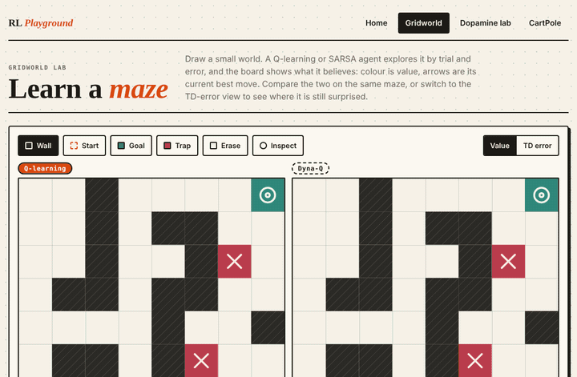

# RL Playground

Interactive reinforcement learning that runs entirely in the browser: no backend, no ML library. The algorithms are plain TypeScript, kept separate from the React UI, unit-tested, and run in Web Workers.



Stack: Vite, React, TypeScript, Canvas, Web Workers, Vitest. The build is static (a `vercel.json` is included but nothing is deployed from this repo).

## The three labs

**Gridworld.** Draw a grid (walls, start, goal, traps; editable rewards and step limit) and watch a tabular agent learn it.
- Q-learning, SARSA and Dyna-Q, alone or side by side on the same maze, seed and hyperparameters.
- Value heatmap (max Q per cell), greedy-policy arrows, the current episode's trail, a reward-per-episode curve.
- TD-error view: per-cell running mean of the absolute TD error, plus a TD-error trace.
- Bellman inspector (the *Inspect* tool): click a cell to see, per action, Q(s,a), the visit count and the arithmetic of the latest update, `r + gamma * max Q(s',.) - Q(s,a) = delta`, with the real numbers.
- Dyna-Q planning-steps slider (0 is plain Q-learning) and a Cliff walk preset where Q-learning and SARSA learn different paths.
- Shareable mazes: the maze, rewards, hyperparameters and mode live in the URL hash.

**Dopamine lab.** A classical-conditioning task: a cue at step *c*, a reward at step *c + delay*, repeated for many trials, learned with TD(0) over a time-step state representation. A trials-by-time heatmap shows the TD error delta, line charts show delta at cue time and at reward time over trials, and there are controls for alpha, gamma, cue time, delay, reward probability and omitted-reward trials. The expected pattern emerges and is covered by unit tests: delta at the reward fades, delta at the cue grows, and an omitted reward gives a negative delta at the expected reward time. This is an analogy inspired by the reward-prediction-error account of dopamine neurons (Schultz, Dayan and Montague, 1997, *A neural substrate of prediction and reward*, Science). It is a minimal tabular learner, not a model of the brain.

**CartPole.** A DQN with a small neural network (4-32-32-2), written from scratch: forward pass, backpropagation, Adam, Huber loss, replay buffer, target network and epsilon decay, all in TypeScript. It trains in a Web Worker while the UI shows the animated cart and pole, live Q-values of the two actions, the return curve, epsilon and buffer size, and a "Run greedy episode" button. It is the "from a table to a network" step: the same `r + gamma * max Q(s',.)` target, with a function approximator instead of a table. The physics are the standard CartPole ones (gravity 9.8, cart mass 1.0, pole mass 0.1, half-length 0.5, force 10, tau 0.02, 12 degree and 2.4 m limits, 500-step cap).

## How RL is shown here

**State.** In the gridworld the state is the cell the agent stands on (`y * width + x`); in CartPole it is four continuous numbers; in the dopamine lab it is the time step since the cue.

**Action.** Gridworld: up, right, down, left, deterministic, walls and borders block movement. CartPole: push left or right.

**Reward.** Goal, trap and step rewards are editable in the gridworld; CartPole pays +1 per step the pole stays up; the dopamine task pays 1 at the reward time (with a chosen probability).

**Q-value.** `Q(s, a)` estimates the discounted reward collected by taking `a` in `s` and acting well afterwards. The heatmap colours each cell by `max_a Q`, the arrows follow `argmax_a Q`. In CartPole a network outputs the two Q-values.

**Epsilon-greedy.** With probability epsilon the agent explores with a random action, otherwise it takes the greedy one (ties broken at random).

**TD error.** `delta = target - Q(s, a)`. The target is `r + gamma * max_a' Q(s', a')` for Q-learning, `r + gamma * Q(s', a')` for SARSA (the action actually taken next), and just `r` at a terminal state. A step-limit timeout is not treated as terminal, so the agent still bootstraps. The update is `Q += alpha * delta`.

### Q-learning vs SARSA
They differ in one term. Q-learning is off-policy: it learns the value of the greedy policy whatever it does while exploring. SARSA is on-policy: its values include the cost of its own random slips. In the Cliff walk preset (Sutton and Barto, example 6.6) with epsilon > 0, Q-learning learns the shortest path along the cliff edge while SARSA learns a longer, safer one; a unit test asserts this on several seeds.

### Dyna-Q
Dyna-Q adds a model of observed transitions and replays `n` random remembered transitions per real step. It reaches a good policy in fewer *real* episodes, at the price of more computation per step.

### TD error and the dopamine analogy
The TD error is the "surprise" that drives learning, large early and shrinking as predictions improve. Its time course in the dopamine lab parallels the shape of the classic dopamine-neuron recordings, which is why it is a popular analogy in neuro-AI. It remains an analogy.

### Share links
`#v1&w=8&h=8&c=...&r=1,-1,-0.04,200&p=0.3,0.95,0.15&m=q` (plus `&n=<planning>` for Dyna-Q). `c` has one character per cell (`_` empty, `w` wall, `S` start, `G` goal, `T` trap), `r` is goal/trap/step reward and max steps, `p` is alpha/gamma/epsilon, `m` is `q`, `s`, `d`, `cmp` (Q-learning vs SARSA) or `cmpd` (Q-learning vs Dyna-Q). Links are validated on load; an invalid link falls back to the example maze. Links made by earlier versions keep working. Lab pages use `#/gridworld`, `#/dopamine` and `#/cartpole`.

## Run it

```bash
npm install
npm run dev        # http://localhost:5173
npm run build      # static output in dist/
npm run preview
```

## Test

```bash
npm test           # Vitest
npm run typecheck
```

The suite (95 tests at the time of writing) covers: the grid environment; the Q-learning, SARSA and Dyna-Q update rules on hand-computed cases; the Cliff-walk contrast between Q-learning and SARSA; Dyna-Q vs Q-learning; the Bellman-inspector records; the share-link codec (round trips and over 20 invalid inputs); the TD(0) dopamine properties; the CartPole physics; a numerical gradient check of the hand-written backpropagation; and a fixed-seed DQN learning test.

## Measured results

These are real numbers from the tests in this repository, on one machine; the seeds are fixed, so they should reproduce.

- **Dyna-Q vs Q-learning** (example maze, alpha 0.5, gamma 0.95, epsilon 0.2, 20 planning steps, 6 seeds): episodes until the greedy policy follows the shortest path (14 moves): Q-learning 41, 32, 40, 29, 35, 33 (mean 35.0); Dyna-Q 3, 12, 3, 3, 19, 10 (mean 8.3). The test requires only a mean under 75% of Q-learning's.
- **CartPole DQN** (4-32-32-2, Adam lr 5e-4, batch 64, gamma 0.99, target sync every 500 steps, replay 20,000, epsilon from 1.0 decaying to 0.05 over about 4,300 steps). A uniformly random policy averages **22.8** steps. Greedy evaluation (5 episodes) every 2,500 training steps:
  - seed 1: 27, 204, 378, 320, 282, 481, 306, 500
  - seed 2: 10, 175, 175, 500, 168, 185, 208, 164
  - seed 3: 11, 255, 131, 134, 131, 183, 149, 230
  - The test requires every seed's mean after the first 5,000 steps to exceed 3x the random policy (measured: 378, 233, 160) and every seed to reach at least 150 steps at some checkpoint (measured bests: 500, 500, 255).

## Limitations

- **The CartPole DQN is not stable.** It learns clearly and often reaches the 500-step cap, but performance oscillates and can regress. Over 30,000 steps with this configuration, the final greedy evaluations of seeds 1 to 4 were 500, 111, 131 and 32 steps. I tuned the learning rate and target-sync interval over a handful of settings and then stopped; it is a faithful small DQN, not a tuned benchmark result. The test therefore checks for clear improvement, not for being solved.
- The learning-rate and epsilon-decay sliders apply immediately to a running agent, which is useful for exploration but not a controlled experiment; press Reset for a clean run.
- The dopamine lab is a one-dimensional, one-cue tabular TD(0) learner with a clock-like state representation. It shows the qualitative prediction-error pattern only. It is not a neural model, and it does not claim to reproduce any published data.
- Gridworld environments are deterministic and small (up to 12 by 12 in the editor); there is no function approximation there. Dyna-Q's model just remembers the last outcome of each state-action pair.
- Browser coverage: developed and checked in Chrome only (desktop and a 390 px viewport, light and dark). Safari and Firefox, and real touch devices, have not been tested.

## Layout

- `src/core/` pure TypeScript with no React or DOM imports: `env`, `agent`, `qlearning`, `sarsa`, `dyna`, `trainer`, `inspect`, `share`, `dopamine`, `cartpole`, `nn`, `dqn`, `cartpoleTrainer`, `rng`
- `src/worker/` the Web Workers (gridworld trainer and CartPole DQN) and their message protocols
- `src/ui/` React shell, labs and canvas drawing

## License

MIT, see [LICENSE](LICENSE).
